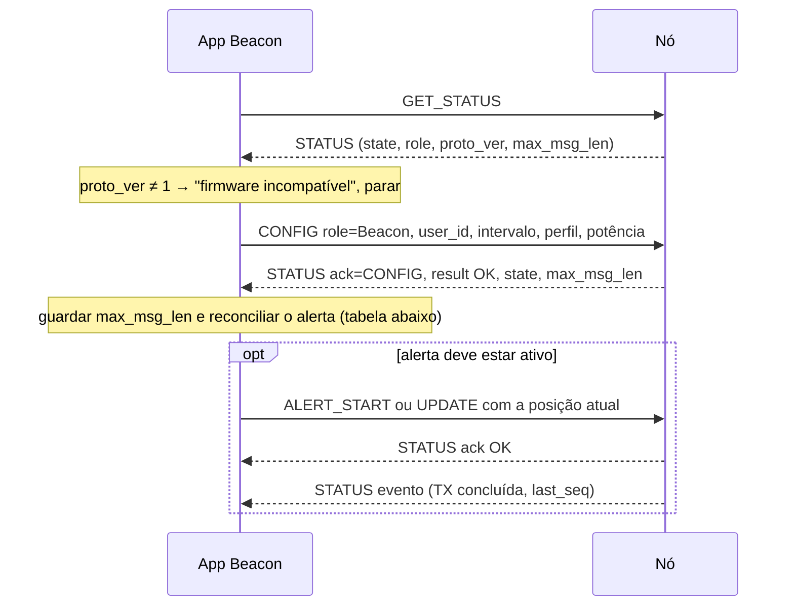

# Manual do aplicativo Beacon

O Beacon roda no celular de quem pode precisar de socorro. Ele configura o nó no papel **Beacon**, ativa o alerta e mantém o nó atualizado com posição, estado, bateria e mensagem. **Quem transmite periodicamente é o nó, não o app:** se o Android suspender o app, o nó continua transmitindo a última posição conhecida (TCC, Seção 3.3.3).

**Pré-requisitos:**
- leia antes o [manual comum](manual_app_comum.md): conexão USB, enquadramento, `NodeLink`, warmup genérico e códigos;
- o formato formal dos quadros está em [`protocolo_serial.md`](protocolo_serial.md).

---

## 1. Dados que o app precisa ter

| Dado | Origem | Observação |
|---|---|---|
| `user_id` (u32 ≠ 0) | servidor, no cadastro (com Internet, antes de ir a campo) | **único** identificador transmitido por rádio; nunca derive do CPF (LGPD) |
| Perfil de rádio | constante compartilhada com o Sniffer | padrão SF9 / 125 kHz / 4/5 / preâmbulo 8 |
| Intervalo de transmissão | preferência do usuário | 30–3600 s, padrão **300 s** |
| Potência | configuração do app | −9 a 22 dBm; sugerido 14 dBm (use 10 dBm na bancada) |
| Estado do alerta | persistido no app (`alertActive`, `status`, `message`) | necessário para reconciliar com o nó ao reconectar (§3) |

Códigos de `status` (TCC, Quadro 4):

| Código | Estado | Código | Estado |
|---|---|---|---|
| 0 | Em segurança (encerra o alerta; o app não escolhe diretamente) | 4 | Incêndio próximo |
| 1 | Perigo, sem detalhamento | 5 | Ilhado por água ou deslizamento |
| 2 | Perdido ou desorientado | 6 | Sem água ou suprimentos |
| 3 | Ferido / precisa de atendimento médico | | |

---

## 2. Payload do alerta (ALERT_START e UPDATE)

Os dois comandos usam o mesmo formato, e ambos levam o **estado completo**:

| Off | Campo | Tipo | Regra |
|---|---|---|---|
| 0 | `lat` | i32 | graus × 10⁷, arredondado; −90..90 |
| 4 | `lon` | i32 | graus × 10⁷; −180..180 |
| 8 | `status` | u8 | 1–6 durante o alerta |
| 9 | `battery` | u8 | 0–100 %, ou `0xFF` se desconhecida (outro valor → `E_PARAM`) |
| 10 | `msg` | N bytes UTF-8 | **N ≤ `max_msg_len` em bytes**, não em caracteres (senão `E_TOA`) |

```kotlin
data class AlertState(
    val latitude: Double, val longitude: Double,
    val status: Int, val batteryPercent: Int?, val message: String,
)

/** Corta a mensagem no limite de bytes sem quebrar um caractere UTF-8 no meio. */
fun utf8Truncate(text: String, maxBytes: Int): ByteArray {
    val out = java.io.ByteArrayOutputStream()
    var i = 0
    while (i < text.length) {
        val cp = text.codePointAt(i)
        val bytes = String(Character.toChars(cp)).toByteArray(Charsets.UTF_8)
        if (out.size() + bytes.size > maxBytes) break
        out.write(bytes)
        i += Character.charCount(cp)
    }
    return out.toByteArray()
}

fun AlertState.toPayload(maxMsgLen: Int): ByteArray {
    val msg = utf8Truncate(message, maxMsgLen)
    return ByteBuffer.allocate(10 + msg.size).order(ByteOrder.BIG_ENDIAN)
        .putInt(Math.round(latitude * 1e7).toInt())
        .putInt(Math.round(longitude * 1e7).toInt())
        .put(status.toByte())
        .put((batteryPercent ?: 0xFF).toByte())
        .put(msg)
        .array()
}
```

**Campo de texto da UI:**
- conte **bytes UTF-8**: "ç", "ã" e emoji ocupam de 2 a 4 bytes;
- mostre "restam X bytes" usando `max_msg_len`. Com o perfil padrão (SF9) são **49 bytes**; em SF10 seriam só 7;
- `utf8Truncate` evita cortar um caractere no meio, mas pode separar emoji compostos (com ZWJ). Prefira bloquear a digitação ao chegar no limite.

---

## 3. Warmup do Beacon (ao conectar a placa)



### 3.1 Reconciliação: o nó pode ter um alerta que o app não espera

O nó grava papel e alerta na flash. Se ele reiniciou ou foi religado com o alerta ativo, **ele mesmo retoma as transmissões** com a última posição gravada, antes de o app conectar. Depois do CONFIG (que **não** encerra um alerta quando o papel continua Beacon), aplique esta tabela:

| `state` na resposta do CONFIG | Alerta ativo no app? | Ação |
|---|---|---|
| BEACON_IDLE | não | nada; tela inicial |
| BEACON_IDLE | sim | `ALERT_START` com posição, estado e mensagem atuais |
| BEACON_ALERT | sim | `UPDATE` com o estado atual do app (sincroniza a mensagem e o estado) |
| BEACON_ALERT | **não** (app reinstalado ou dados apagados) | o app **não sabe** o conteúdo do alerta, porque o STATUS não traz status nem mensagem. Mostre "Há um alerta ativo neste dispositivo" com duas opções: **Continuar** (escolher estado e mensagem e enviar `ALERT_START`) ou **Encerrar** (`ALERT_STOP`, que transmite "em segurança") |

O STATUS de uma placa nova ou apagada, antes do CONFIG, vem com `state = WAIT_CONFIG` (0) e `role = 0`. Se a placa já foi usada como Sniffer, vem com `role = 2`. O CONFIG resolve os dois casos.

---

## 4. Durante o alerta

| Ação do usuário ou evento | Comando | Efeito no nó |
|---|---|---|
| Aciona o alerta | `ALERT_START` | transmite **imediatamente** (ou 10 s após a transmissão anterior, se houver uma mais recente) e depois a cada `intervalo ± 10 %` |
| Nova leitura de GPS | `UPDATE` (estado completo) | guarda a posição; **não** transmite agora (vai no próximo ciclo) |
| Muda o estado ou a mensagem | `UPDATE` | transmite **imediatamente**, respeitando 10 s desde a transmissão anterior |
| Bateria do celular mudou | `UPDATE` | vai no próximo ciclo |
| Muda o intervalo | `CONFIG` (mesmo papel) | o alerta continua; a transmissão já agendada mantém o horário e o novo intervalo vale a partir dela |
| Encerra o alerta | `ALERT_STOP` | transmite um último pacote com `status = 0` e volta a BEACON_IDLE |

### 4.1 Foreground service

Enquanto o alerta estiver ativo, mantenha um **foreground service** com notificação visível. No Android 14+, declare os tipos `location` e `connectedDevice`. O serviço deve:

- obter localização (`FusedLocationProviderClient`; prioridade alta, intervalo de 15 a 60 s) e mandar `UPDATE` a cada nova leitura. **Não** mande UPDATE mais de uma vez a cada 10 s: não há ganho, porque só posição não dispara transmissão;
- ler a bateria (`BatteryManager.BATTERY_PROPERTY_CAPACITY`) e incluí-la no UPDATE;
- pedir isenção de otimização de bateria (`ACTION_REQUEST_IGNORE_BATTERY_OPTIMIZATIONS`), para o Android não matar o serviço;
- se o serviço morrer mesmo assim, o nó **continua transmitindo** a última posição. O usuário só perde a atualização da posição.

**Posição antes do primeiro fix:** ALERT_START exige coordenadas. Use a última posição conhecida (`lastLocation`); se não houver nenhuma, espere o primeiro fix, mostrando "obtendo localização…" com um botão "enviar sem posição". Nunca envie (0, 0) como posição real: o Sniffer trata isso como suspeito.

### 4.2 Eventos que o app recebe durante o alerta

| Evento | Significado | UI |
|---|---|---|
| STATUS `ack_type=0`, `result=OK`, `last_seq` aumentou | uma transmissão terminou | "Última transmissão: 14:32:05", com hora do celular |
| STATUS `ack_type=0`, `result=E_RADIO` | transmissão falhou; o nó tenta de novo em até 30 s | aviso discreto; vários seguidos → "problema no rádio" |
| STATUS `ack_type=0`, `result=E_BUSY` | o nó não conseguiu enfileirar; tenta de novo em 1 s | ignorar |

Sobre o **`seq`**:
- ele aumenta a cada transmissão e é persistido;
- depois de um reset do nó, ele **pula 16** (por exemplo, de 27 para 32). Isso é proposital, para o Sniffer não confundir pacotes novos com repetidos;
- **não** use saltos de `seq` no Beacon para concluir que houve falha.

### 4.3 Encerramento

1. Envie `ALERT_STOP` e aguarde o ACK OK.
2. Aguarde o STATUS evento da transmissão final (`result=OK`).
3. Só então mostre "alerta encerrado, equipe avisada de que você está em segurança".

Se vier `E_RADIO`, mostre que o aviso de segurança pode não ter chegado à equipe.

> **Limitação conhecida (protocolo v1):** não há comando para reenviar só o pacote "em segurança". Um `ALERT_STOP` com o alerta já encerrado não transmite nada. Um `ALERT_START` antes de um novo `ALERT_STOP` transmitiria primeiro um estado de perigo, e isso **não** deve ser feito. Se esse caso for importante, a solução é no firmware: fazer o `ALERT_STOP` com o alerta inativo retransmitir o status 0.

---

## 5. Desconexões

| Situação | O que acontece no nó | O que o app faz |
|---|---|---|
| App em segundo plano ou morto | continua transmitindo a última posição | ao voltar: warmup completo (§3) |
| Cabo desconectado | **o nó desliga** (é alimentado pelo celular): as transmissões param | avisar: "Dispositivo desconectado: o alerta NÃO está sendo transmitido" |
| Cabo reconectado | o nó liga, retoma o alerta gravado e transmite na hora | warmup completo; a reconciliação (§3.1) cai no caso BEACON_ALERT |
| Nó não responde ao GET_STATUS de 30 em 30 s (3 vezes) | travado; o watchdog reinicia em cerca de 45 s | "Dispositivo não responde"; reabrir a porta |

---

## 6. Checklist de implementação

- [ ] `device_filter.xml` + abertura automática ao conectar; tratar `DETACHED`.
- [ ] `NodeLink` do manual comum, com testes usando os vetores de §2.1 de lá.
- [ ] Warmup: `GET_STATUS` → checar `proto_ver` → `CONFIG` → reconciliar (§3.1).
- [ ] Campo de mensagem limitado em **bytes** (`max_msg_len`).
- [ ] Validação local: coordenadas, bateria 0–100 ou nulo, `user_id ≠ 0`, intervalo 30–3600.
- [ ] Foreground service (localização + bateria → UPDATE).
- [ ] Hora da última transmissão a partir dos STATUS evento.
- [ ] `GET_STATUS` a cada 30 s para detectar nó travado.
- [ ] Persistir no app: `user_id`, `alertActive`, `status`, `message`, intervalo.
- [ ] Teste de ponta a ponta com uma segunda placa como Sniffer:
  ```bash
  .venv/bin/python tools/node_cli.py -p /dev/ttyUSB1 config --role sniffer --follow
  ```
