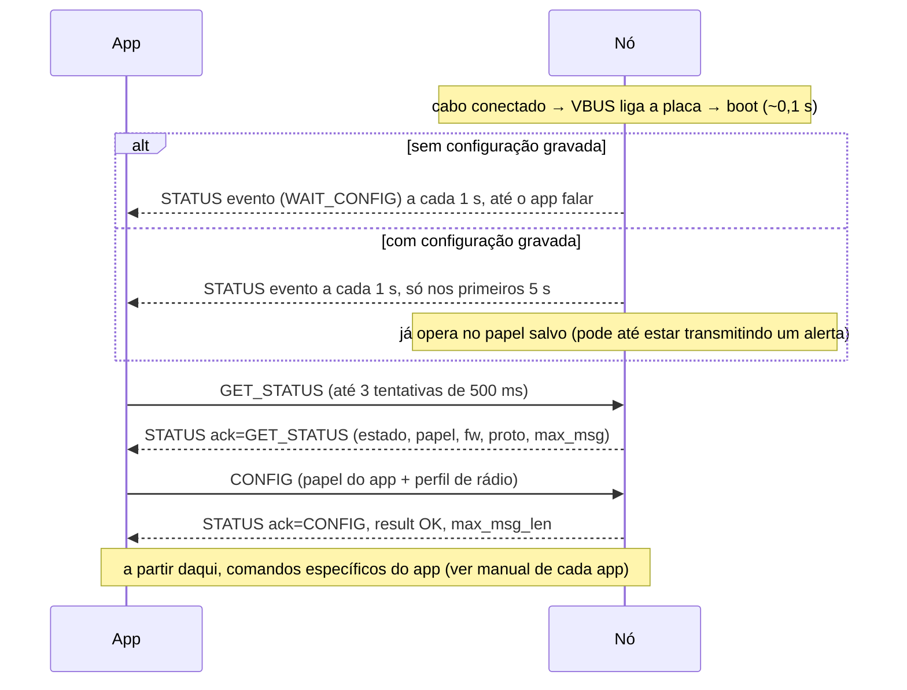

# Manual dos aplicativos: camada comum de comunicação com o nó

Este guia vale para os **dois** aplicativos, Beacon e Sniffer.

- **Formato dos quadros:** a especificação formal fica em [`protocolo_serial.md`](protocolo_serial.md).
- **Este guia:** como implementar a camada serial no Android, que o TCC (Seção 3.4.3) prevê como componente compartilhado.
- **Comportamento de cada app:** [`manual_app_beacon.md`](manual_app_beacon.md) e [`manual_app_sniffer.md`](manual_app_sniffer.md).

> Firmware de referência: v1.0.0, protocolo v1, validado em bancada com duas placas E77-900MBL-01 em 08/10/2026.
> Implementação de referência executável: `tools/node_cli.py`. Em caso de dúvida, o comportamento dela é o correto.

---

## 1. Conexão USB

| Item | Valor |
|---|---|
| Conversor da placa | CH340 (WCH), VID `0x1A86` (6790), PID `0x7523` (29987) |
| Biblioteca | [usb-serial-for-android](https://github.com/mik3y/usb-serial-for-android), driver `Ch34xSerialDriver` |
| Parâmetros | 115200 bps, 8 bits, sem paridade, 1 stop bit (`PARITY_NONE`, `STOPBITS_1`) |
| Controle de fluxo | nenhum |
| DTR/RTS | podem ficar no padrão da biblioteca: abrir a porta com DTR/RTS ativos não reinicia a placa (verificado em bancada) |
| Alimentação | a placa é alimentada pelo VBUS do celular: **desconectar o cabo desliga o nó** |

`res/xml/device_filter.xml`:

```xml
<resources>
    <usb-device vendor-id="6790" product-id="29987" />
</resources>
```

`AndroidManifest.xml`: na activity principal, inclua `USB_DEVICE_ATTACHED` com o `device_filter`. Assim o app abre sozinho quando a placa é conectada e a permissão USB fica lembrada.

```xml
<intent-filter>
    <action android:name="android.hardware.usb.action.USB_DEVICE_ATTACHED" />
</intent-filter>
<meta-data android:name="android.hardware.usb.action.USB_DEVICE_ATTACHED"
           android:resource="@xml/device_filter" />
```

Registre também `UsbManager.ACTION_USB_DEVICE_DETACHED`, para saber quando o nó foi desconectado.

---

## 2. Enquadramento (o que a camada serial precisa fazer)

```
SOF 0x7E | type u8 | len u8 | payload[len] | crc16 u16 (big-endian)
```

- O **CRC-16/CCITT-FALSE** (poly `0x1021`, init `0xFFFF`) é calculado sobre `type | len | payload`.
- **Todos os inteiros são big-endian.** Use `ByteBuffer.order(ByteOrder.BIG_ENDIAN)`.
- **Não existe byte stuffing.** `0x7E` pode aparecer no meio do quadro, então não procure o próximo `0x7E` para delimitar quadros: use o campo `len`.
- **Envie cada quadro numa única chamada `write()`.** Se passar mais de **100 ms** entre dois bytes do mesmo quadro, o nó descarta o quadro.

### 2.1 Vetores de teste

Use-os em testes unitários da camada Kotlin:

| Entrada | Saída esperada |
|---|---|
| `crc16("123456789")` | `0x29B1` |
| GET_STATUS | `7E 05 00 E2 FA` |
| CONFIG Beacon, user `0x0A1B2C3D`, 300 s, SF9/125 kHz, CR 4/5, 14 dBm, preâmbulo 8 | `7E 01 0F 01 01 0A 1B 2C 3D 01 2C 09 00 01 0E 00 08 00 84 F3` |
| ALERT_START lat −27,5°, lon −50,3°, status 2, bateria 80 %, msg `perdido` | `7E 02 11 EF 9B D5 40 E2 04 D4 40 02 50 70 65 72 64 69 64 6F 5E C6` |

### 2.2 Código de referência em Kotlin

Este código é uma tradução direta de `tools/node_cli.py`, que foi validado na placa. **O código Kotlin em si não foi compilado nem testado aqui:** valide com os vetores acima.

```kotlin
const val SOF: Byte = 0x7E
const val MAX_PAYLOAD = 250

object FrameType {
    const val CONFIG = 0x01; const val ALERT_START = 0x02; const val UPDATE = 0x03
    const val ALERT_STOP = 0x04; const val GET_STATUS = 0x05
    const val RX_ALERT = 0x81; const val STATUS = 0x82; const val LOG = 0x83
    // 0x0F ENTER_BOOTLOADER existe, mas os apps NUNCA devem enviá-lo
}

object Crc16 {
    fun compute(data: ByteArray, offset: Int = 0, length: Int = data.size - offset): Int {
        var crc = 0xFFFF
        for (i in offset until offset + length) {
            crc = crc xor ((data[i].toInt() and 0xFF) shl 8)
            repeat(8) {
                crc = if (crc and 0x8000 != 0) ((crc shl 1) xor 0x1021) and 0xFFFF
                      else (crc shl 1) and 0xFFFF
            }
        }
        return crc
    }
}

fun encodeFrame(type: Int, payload: ByteArray = ByteArray(0)): ByteArray {
    require(payload.size <= MAX_PAYLOAD)
    val out = ByteArray(payload.size + 5)
    out[0] = SOF
    out[1] = type.toByte()
    out[2] = payload.size.toByte()
    payload.copyInto(out, 3)
    val crc = Crc16.compute(out, 1, 2 + payload.size)
    out[3 + payload.size] = (crc shr 8).toByte()
    out[4 + payload.size] = crc.toByte()
    return out
}

class Frame(val type: Int, val payload: ByteArray)

/**
 * Mesmas regras do firmware:
 *  - CRC errado ou len > 250: descarta só o byte SOF e reprocessa o resto;
 *  - pausa > 100 ms no meio de um quadro: reprocessa os bytes pendentes e
 *    descarta o que estiver incompleto (um 0x7E espúrio com len grande
 *    seguraria os quadros reais que vêm atrás dele).
 */
class FrameDecoder(private val byteTimeoutMs: Long = 100) {
    private var buf = ByteArray(1024)
    private var len = 0
    private var lastByteAt = 0L
    var errors = 0
        private set

    fun feed(data: ByteArray, count: Int, nowMs: Long): List<Frame> {
        val out = poll(nowMs).toMutableList()
        lastByteAt = nowMs
        if (len + count > buf.size) buf = buf.copyOf(maxOf(buf.size * 2, len + count))
        data.copyInto(buf, len, 0, count)
        len += count
        drain(stale = false, out)
        return out
    }

    /** Chame quando read() voltar sem dados. */
    fun poll(nowMs: Long): List<Frame> {
        if (len == 0 || nowMs - lastByteAt <= byteTimeoutMs) return emptyList()
        return mutableListOf<Frame>().also { drain(stale = true, it) }
    }

    private fun drop(n: Int) { buf.copyInto(buf, 0, n, len); len -= n }

    private fun drain(stale: Boolean, out: MutableList<Frame>) {
        while (true) {
            var start = -1
            for (i in 0 until len) if (buf[i] == SOF) { start = i; break }
            if (start < 0) { len = 0; return }
            drop(start)
            val payloadLen = if (len >= 3) buf[2].toInt() and 0xFF else 0
            if (payloadLen > MAX_PAYLOAD) { errors++; drop(1); continue }
            val total = payloadLen + 5
            if (len < maxOf(total, 3)) {
                if (stale) { errors++; drop(1); continue } else return
            }
            val crcRx = ((buf[3 + payloadLen].toInt() and 0xFF) shl 8) or
                        (buf[4 + payloadLen].toInt() and 0xFF)
            if (Crc16.compute(buf, 1, 2 + payloadLen) == crcRx) {
                out += Frame(buf[1].toInt() and 0xFF, buf.copyOfRange(3, 3 + payloadLen))
                drop(total)
            } else {
                errors++; drop(1)
            }
        }
    }
}
```

---

## 3. Modelo de requisição e resposta

- **Todo quadro app → nó recebe exatamente um STATUS** com `ack_type` igual ao tipo enviado.
- **Não há identificador de requisição.** Portanto, envie **um comando por vez**, serializado com um `Mutex`, e espere o ACK antes do próximo.
- **Timeout do ACK:** 500 ms. **Tentativas:** até 3.
- **Todos os comandos podem ser repetidos com segurança:**
  - CONFIG e UPDATE são idempotentes;
  - ALERT_STOP com o alerta já encerrado não faz nada;
  - ALERT_START repetido com o alerta já ativo atualiza o estado e, no máximo, gera mais uma transmissão (respeitando o intervalo mínimo de 10 s).
- **STATUS com `ack_type = 0` são eventos espontâneos** (warmup, resultado de transmissão) e podem chegar a qualquer momento, inclusive entre o envio e o ACK. Nunca os confunda com o ACK.

```kotlin
sealed interface NodeEvent {
    data class Status(val status: NodeStatus) : NodeEvent          // ack_type == 0
    data class Alert(val alert: RxAlert, val receivedAtMs: Long) : NodeEvent
    data class Log(val text: String) : NodeEvent
    data object Disconnected : NodeEvent
}

class NodeTimeoutException(val frameType: Int) : Exception("sem ACK para 0x%02X".format(frameType))

class NodeLink(private val port: UsbSerialPort, private val scope: CoroutineScope) {
    private val decoder = FrameDecoder()
    private val requestMutex = Mutex()
    @Volatile private var pending: Pair<Int, CompletableDeferred<NodeStatus>>? = null
    val events = MutableSharedFlow<NodeEvent>(extraBufferCapacity = 64)

    fun start(): Job = scope.launch(Dispatchers.IO) {
        val buf = ByteArray(256)
        while (isActive) {
            val n = try { port.read(buf, 50) } catch (e: IOException) {
                events.emit(NodeEvent.Disconnected); break
            }
            val now = SystemClock.elapsedRealtime()
            val frames = if (n > 0) decoder.feed(buf, n, now) else decoder.poll(now)
            frames.forEach { dispatch(it) }
        }
    }

    private suspend fun dispatch(f: Frame) {
        when (f.type) {
            FrameType.STATUS -> {
                val s = parseStatus(f.payload) ?: return
                val p = pending
                if (s.ackType != 0 && p != null && p.first == s.ackType) p.second.complete(s)
                else events.emit(NodeEvent.Status(s))
            }
            FrameType.RX_ALERT -> parseRxAlert(f.payload)?.let {
                events.emit(NodeEvent.Alert(it, System.currentTimeMillis()))
            }
            FrameType.LOG -> events.emit(NodeEvent.Log(String(f.payload, Charsets.US_ASCII)))
            else -> Unit   // tipos desconhecidos: ignorar (compatibilidade futura)
        }
    }

    /** Envia um comando e devolve o STATUS de confirmação. */
    suspend fun request(type: Int, payload: ByteArray = ByteArray(0)): NodeStatus =
        requestMutex.withLock {
            repeat(3) {
                val ack = CompletableDeferred<NodeStatus>()
                pending = type to ack
                withContext(Dispatchers.IO) { port.write(encodeFrame(type, payload), 200) }
                val r = withTimeoutOrNull(500) { ack.await() }
                pending = null
                if (r != null) return r
            }
            throw NodeTimeoutException(type)
        }
}
```

---

## 4. Payloads

Os tamanhos e offsets abaixo são exatos. A coluna "Kotlin" indica a conversão sem sinal ou com sinal.

### 4.1 STATUS (nó → app), 14 bytes

| Off | Campo | Tipo | Kotlin |
|---|---|---|---|
| 0 | `ack_type` | u8 | `get().toInt() and 0xFF` |
| 1 | `result` | u8 | idem |
| 2 | `state` | u8 | 0 WAIT_CONFIG, 1 BEACON_IDLE, 2 BEACON_ALERT, 3 SNIFFER_RX |
| 3 | `role` | u8 | 0 nenhum, 1 Beacon, 2 Sniffer |
| 4 | `fw_ver` | 3 × u8 | major.minor.patch |
| 7 | `proto_ver` | u8 | **deve ser 1** |
| 8 | `max_msg_len` | u8 | limite da mensagem em **bytes UTF-8** |
| 9 | `last_seq` | u16 | `getShort().toInt() and 0xFFFF` |
| 11 | `err_flags` | u16 | bits, ver §6 |
| 13 | `reset_cause` | u8 | ver §6 |

```kotlin
data class NodeStatus(
    val ackType: Int, val result: Int, val state: Int, val role: Int,
    val firmware: String, val protoVersion: Int, val maxMsgLen: Int,
    val lastSeq: Int, val errFlags: Int, val resetCause: Int,
)

fun parseStatus(p: ByteArray): NodeStatus? {
    if (p.size < 14) return null
    val b = ByteBuffer.wrap(p).order(ByteOrder.BIG_ENDIAN)
    fun u8() = b.get().toInt() and 0xFF
    return NodeStatus(
        ackType = u8(), result = u8(), state = u8(), role = u8(),
        firmware = "${u8()}.${u8()}.${u8()}", protoVersion = u8(), maxMsgLen = u8(),
        lastSeq = b.getShort().toInt() and 0xFFFF, errFlags = b.getShort().toInt() and 0xFFFF,
        resetCause = u8(),
    )
}
```

Payloads maiores que 14 bytes são aceitáveis: versões futuras podem acrescentar campos no fim. Leia os 14 primeiros e ignore o resto.

### 4.2 CONFIG (app → nó), 15 bytes

```kotlin
enum class Role(val code: Int) { BEACON(1), SNIFFER(2) }

data class RadioProfile(val sf: Int, val bwCode: Int, val cr: Int, val preamble: Int)

/** Perfil único do sistema: Beacon e Sniffer PRECISAM usar o mesmo. */
val DEFAULT_PROFILE = RadioProfile(sf = 9, bwCode = 0 /*125 kHz*/, cr = 1 /*4/5*/, preamble = 8)

fun configPayload(role: Role, userId: Long, intervalS: Int, profile: RadioProfile, txPowerDbm: Int): ByteArray =
    ByteBuffer.allocate(15).order(ByteOrder.BIG_ENDIAN)
        .put(1.toByte())                       // proto_ver
        .put(role.code.toByte())
        .putInt(userId.toInt())                // u32
        .putShort(intervalS.toShort())         // 30..3600
        .put(profile.sf.toByte())
        .put(profile.bwCode.toByte())
        .put(profile.cr.toByte())
        .put(txPowerDbm.toByte())              // -9..22
        .putShort(profile.preamble.toShort())
        .put(0.toByte())                       // hop: 0 (salto de frequência ainda não existe)
        .array()
```

### 4.3 RX_ALERT (nó → app), 19 + N bytes

O Sniffer usa esta mensagem; ela fica aqui porque o `NodeLink` a decodifica.

```kotlin
data class RxAlert(
    val userId: Long,        // u32
    val seq: Int,            // u16
    val latE7: Int, val lonE7: Int,
    val status: Int,         // 0..6 conhecidos; outros valores podem surgir
    val battery: Int?,       // null = desconhecida (0xFF)
    val rssiDbm: Int,        // i16
    val snrDb: Int,          // i8
    val message: String,
)

fun parseRxAlert(p: ByteArray): RxAlert? {
    if (p.size < 19) return null
    val b = ByteBuffer.wrap(p).order(ByteOrder.BIG_ENDIAN)
    val userId = b.getInt().toLong() and 0xFFFFFFFFL
    val seq = b.getShort().toInt() and 0xFFFF
    val lat = b.getInt()
    val lon = b.getInt()
    val status = b.get().toInt() and 0xFF
    val battery = (b.get().toInt() and 0xFF).takeIf { it != 0xFF }
    val rssi = b.getShort().toInt()        // com sinal
    val snr = b.get().toInt()              // com sinal
    val msg = String(p, 19, p.size - 19, Charsets.UTF_8)   // o firmware já saneou o UTF-8
    return RxAlert(userId, seq, lat, lon, status, battery, rssi, snr, msg)
}
```

### 4.4 Perfil de rádio e tamanho máximo da mensagem

O canal é fixo, **916,8 MHz**. Ele **não** é configurável pelo app nesta versão.

`max_msg_len` com CR 4/5 e preâmbulo 8 (limite de 400 ms no ar):

| BW \ SF | 7 | 8 | 9 | 10 | 11 | 12 |
|---|---|---|---|---|---|---|
| **125 kHz** | 231 | 121 | **49** | 7 | recusado | recusado |
| 250 kHz | 231 | 231 | 139 | 57 | 10 | recusado |
| 500 kHz | 231 | 231 | 231 | 157 | 65 | 13 |

**Use sempre o `max_msg_len` devolvido pelo nó**, e não esta tabela: ela é só para planejamento.

**O perfil padrão do sistema é SF9 / 125 kHz / 4/5 / preâmbulo 8, com 49 bytes de mensagem.** Se o Beacon e o Sniffer usarem perfis diferentes, **nenhum pacote é recebido** e não aparece erro em lugar nenhum. É o erro de integração mais provável: centralize o perfil numa constante compartilhada pelos dois apps.

---

## 5. Warmup: o que acontece ao conectar a placa



Regras:

1. **Não dependa dos STATUS espontâneos.** Até o usuário conceder a permissão USB, os 5 s de warmup podem ter passado. **Sempre comece com `GET_STATUS`**, e use os eventos só como sinal de que o nó está vivo.
2. **Verifique `proto_ver == 1`.** Se for diferente, mostre "firmware incompatível" e não envie mais nada.
3. **Envie CONFIG em toda conexão**, mesmo que o nó já esteja no papel certo. É barato e garante que o perfil de rádio é o do app.
4. **Guarde `max_msg_len`** da resposta do CONFIG: ele depende do perfil.
5. **Depois do primeiro quadro válido do app, o nó para de enviar STATUS espontâneos de warmup.** Daí em diante ele só fala quando responde, quando transmite (Beacon) ou quando recebe um alerta (Sniffer).

---

## 6. Códigos e o que o app deve fazer

| `result` | Nome | Quando | Ação no app |
|---|---|---|---|
| 0 | OK | — | — |
| 2 | E_LEN | payload curto ou longo demais | bug do app: registrar |
| 3 | E_PARAM | campo fora da faixa (coordenada, bateria, potência, intervalo, user_id = 0 no Beacon) | bug do app: validar antes de enviar |
| 4 | E_STATE | comando inválido no estado atual (ex.: ALERT_START sem CONFIG Beacon) | refazer o warmup |
| 5 | E_TOA | mensagem maior que `max_msg_len`, ou perfil que passa de 400 ms | limitar o campo de texto em bytes |
| 6 | E_FLASH | configuração aplicada, mas não gravada | avisar: "o dispositivo pode esquecer a configuração se reiniciar" |
| 7 | E_TYPE | tipo desconhecido | firmware antigo |
| 8 | E_BUSY | o nó não conseguiu enfileirar a transmissão (evento) | nada: o nó tenta de novo em 1 s |
| 9 | E_RADIO | transmissão falhou (evento) | mostrar alerta de falha de rádio; o nó tenta de novo em até 30 s |

`err_flags` são bits **acumulados desde o último reset**. Mostre-os numa tela de diagnóstico, não para o usuário final:

| Bit | Flag | Bit | Flag |
|---|---|---|---|
| 0 | quadro serial corrompido | 5 | rádio reinicializado após erros |
| 1 | overrun da UART | 6 | transmitiu com canal ocupado após 5 tentativas de CAD |
| 2 | configuração gravada inválida | 7 | fila de TX serial cheia |
| 3 | falha de escrita na flash | 8 | cristal 32,768 kHz falhou, RTC no oscilador interno |
| 4 | timeout de TX no rádio | | |

`reset_cause`: 0 desconhecida, 1 power-on, 2 pino de reset, 3 software, 4 **watchdog** (falha interna), 5 WWDG, 6 low-power, 7 brown-out.

---

## 7. Saúde da conexão

- **Detecção de queda:** trate `ACTION_USB_DEVICE_DETACHED` e as `IOException` no `read()`. **Desconectar o cabo desliga o nó**, porque ele não tem bateria.
- **Detecção de nó travado:** fora do warmup o nó pode ficar minutos sem falar. Envie `GET_STATUS` a cada **30 s**; depois de 3 timeouts seguidos, mostre "dispositivo não responde" e tente reabrir a porta. O watchdog do nó o reinicia sozinho em cerca de 45 s se uma task travar (10 s de supervisão mais cerca de 33 s do IWDG).
- **Reconexão:** sempre repita o warmup completo (§5).
- **Quadros `LOG` (0x83):** só existem no firmware Debug. Ignore-os, ou mostre-os numa tela de desenvolvedor.
- **Nunca envie `ENTER_BOOTLOADER` (0x0F) pelos apps.** Ele tira o nó de operação até ser regravado.

---

## 8. Testando sem o hardware do outro lado

- `tools/node_cli.py` (ver README) emula o aplicativo. Use-o para comparar bytes com a implementação Kotlin.
- Com duas placas, uma como Beacon pelo app e outra como Sniffer pelo `node_cli.py --follow` (ou o inverso), dá para testar cada app isoladamente.
- O `node_cli.py selftest` mostra como o nó reage a ruído e a quadros inválidos.
