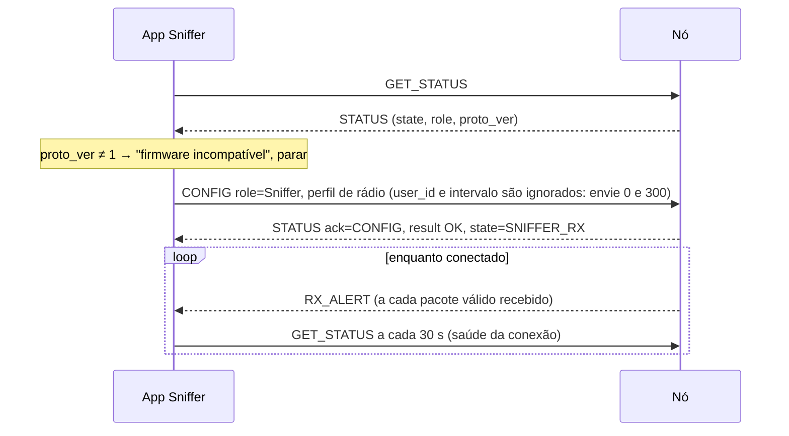

# Manual do aplicativo Sniffer

O Sniffer roda no celular do agente de emergência. Ele configura o nó no papel **Sniffer**: rádio em recepção contínua, e cada alerta válido recebido é entregue ao app como `RX_ALERT`, com RSSI e SNR. O app mantém, para cada usuário, a última posição, o histórico, o estado, a mensagem, a bateria e a hora do último contato, e mostra tudo num mapa offline (TCC, Seção 3.4.2).

**Pré-requisitos:**
- leia antes o [manual comum](manual_app_comum.md): conexão USB, enquadramento, `NodeLink`, `parseRxAlert`, warmup genérico e códigos;
- o formato formal dos quadros está em [`protocolo_serial.md`](protocolo_serial.md).

---

## 1. Warmup do Sniffer



- **Envie CONFIG em toda conexão.** Uma placa usada antes como Beacon volta como Beacon; se ela tiver um alerta gravado, **o CONFIG Sniffer encerra esse alerta sem transmitir**. Isso é desejável.
- **O perfil de rádio (SF, BW, CR, preâmbulo) precisa ser idêntico ao do Beacon.** Se for diferente, nada é recebido e nenhum erro aparece. Use a constante compartilhada `DEFAULT_PROFILE` do manual comum. Mostre o perfil ativo numa tela de diagnóstico.
- **A potência no CONFIG do Sniffer é irrelevante**, porque ele não transmite. Mande o mesmo valor do Beacon.
- **Comandos de alerta são recusados no Sniffer** com `E_STATE`: `ALERT_START`, `UPDATE` e `ALERT_STOP`.

---

## 2. O que o firmware já filtra

Cada `RX_ALERT` que chega ao app já passou por estas etapas no nó:

1. o CRC LoRa do pacote está correto;
2. a porta é a de alerta (`0x01`), o tamanho é ≥ 17 bytes e as coordenadas estão dentro de ±90° / ±180°;
3. o par `(user_id, seq)` **não** foi recebido nos últimos 10 minutos (cache de 32 entradas);
4. a mensagem é UTF-8 válido (bytes inválidos viram `?`).

O cache de duplicatas do nó é perdido quando ele reinicia. Por isso o app também deve deduplicar (§3.2).

---

## 3. Modelo de dados do app

```kotlin
data class Fix(
    val latE7: Int, val lonE7: Int,
    val receivedAtMs: Long,          // relógio do CELULAR: o pacote não tem timestamp
    val seq: Int, val rssiDbm: Int, val snrDb: Int,
)

data class TrackedUser(
    val userId: Long,
    var status: Int,
    var message: String,
    var batteryPercent: Int?,        // null = desconhecida
    var lastFix: Fix,
    val history: MutableList<Fix>,   // trilha no mapa
    var lastContactMs: Long,
)
```

### 3.1 Recebendo um RX_ALERT

```kotlin
fun onAlert(a: RxAlert, receivedAtMs: Long) {
    if (isDuplicate(a.userId, a.seq, receivedAtMs)) return
    val fix = Fix(a.latE7, a.lonE7, receivedAtMs, a.seq, a.rssiDbm, a.snrDb)
    val u = users.getOrPut(a.userId) { TrackedUser(a.userId, a.status, a.message, a.battery, fix, mutableListOf(), receivedAtMs) }
    u.status = a.status
    u.message = a.message
    u.batteryPercent = a.battery
    u.lastFix = fix
    u.lastContactMs = receivedAtMs
    if (!(a.latE7 == 0 && a.lonE7 == 0)) u.history += fix     // (0,0) = sem posição válida
    persist(u)                                                 // sobreviver a reinícios do app
}
```

**Regras de interpretação:**

| Campo | Regra |
|---|---|
| Hora | **não existe no pacote.** Use a hora de recepção do celular. O pacote recebido é o mais recente, mas pode ter até um intervalo de atraso em relação à posição real |
| `status = 0` | o usuário **encerrou o alerta** (em segurança). Mantenha no mapa com outra aparência e não gere alerta sonoro |
| `status` 1–6 | ícone ou cor por estado (Quadro 4 do TCC) |
| `status` ≥ 7 | código novo, de uma versão futura: mostre "estado desconhecido (N)", **não descarte** |
| `battery = null` | "bateria desconhecida" |
| `lat = lon = 0` | o Beacon não tinha posição: mantenha o último ponto válido e sinalize |
| `message` vazia | normal: o `status` já carrega a informação essencial |
| `rssi` / `snr` | sinal do **último** pacote. Valores típicos: −40 dBm e +10 dB perto; perto de −120 dBm e SNR negativo (até cerca de −12 dB em SF9) no limite do alcance |

### 3.2 Deduplicação e sequência

- **Chave de deduplicação:** `(userId, seq)` vista nos últimos 10 minutos. Mantenha o conjunto também em disco, para não duplicar pontos após reiniciar o app.
- **O `seq` é u16 e dá a volta** (65535 → 0). Compare com aritmética módulo 65536.
- **Saltos de `seq` não significam necessariamente perda:** quando o nó Beacon reinicia, o `seq` pula 16 de propósito. Ao estimar a taxa de recepção (Seção 4 do TCC), conte os saltos pequenos como perdas e trate saltos de exatamente 16 logo após um intervalo longo sem contato como provável reinício do Beacon.
- **Pacotes chegam fora de ordem raramente**, porque é um único salto. Se `seq` for menor que o último visto (módulo 65536) dentro da janela, **não** regrida a posição atual: só acrescente ao histórico.

### 3.3 Usuários sem contato

O Sniffer **não sabe** o intervalo configurado em cada Beacon, porque ele não vai no pacote. Use um limite configurável, com padrão de **3 × 300 s = 15 min**, e destaque quem passar dele ("sem contato há 23 min"). Usuários com `status = 0` não entram nessa regra.

### 3.4 Identidade

O pacote só traz o `user_id` (LGPD: o CPF nunca vai pelo rádio). Para mostrar nome e contato, o app precisa de uma **tabela `user_id` → cadastro baixada do servidor antes de ir a campo**, porque no campo não há Internet. Usuários fora da tabela aparecem como `0x0A1B2C3D`, nunca são descartados.

---

## 4. Mapa e busca

- **Mapas offline**, baixados antes do deslocamento (por exemplo, osmdroid ou Mapbox com tiles em cache).
- Para cada usuário: marcador na última posição (cor e ícone pelo `status`) e trilha com o `history`, que indica a direção de deslocamento.
- **Modo busca por sinal**, para quando a posição for imprecisa ou estiver desatualizada:
  - mostre o RSSI e o SNR dos últimos pacotes do usuário selecionado, com tendência (subindo ou descendo);
  - o RSSI aumenta à medida que o agente se aproxima;
  - como só chega um pacote por intervalo, ajuste o intervalo do Beacon ou peça ao usuário uma mudança de estado: cada mudança gera uma transmissão imediata.

---

## 5. Eventos e saúde da conexão

| Evento | Significado | UI |
|---|---|---|
| `RX_ALERT` | alerta recebido | atualizar mapa e lista; notificação para alerta novo ou mudança de estado |
| STATUS `ack_type=0` | só no warmup (primeiros 5 s ou em WAIT_CONFIG) | ignorar após o CONFIG |
| `GET_STATUS` sem resposta 3× seguidas | nó travado ou desconectado | "receptor não responde": **alertas podem estar sendo perdidos** |
| `DETACHED` | cabo desconectado: o nó desliga | aviso bem visível: o receptor não está operando |
| `err_flags` bit 5 (rádio reinicializado) | o rádio teve falhas e foi reiniciado | registrar na tela de diagnóstico |

Fora do warmup, um Sniffer sem alertas no ar **fica em silêncio**. É o `GET_STATUS` periódico que mostra que o receptor está vivo, e não a chegada de pacotes. Mostre "receptor ativo · último check 12 s atrás".

---

## 6. Dados para a avaliação do TCC (Seção 4)

Registre cada recepção num arquivo, para os testes de campo:

```
received_at_iso, user_id, seq, lat, lon, status, battery, rssi_dbm, snr_db, msg_len
```

Junto com a posição do próprio Sniffer (GPS do celular do agente) na hora da recepção, isso permite calcular:
- **alcance:** distância entre a posição do Beacon e a do Sniffer;
- **taxa de recepção:** `seq` recebidos ÷ `seq` esperados, com o cuidado da §3.2;
- **qualidade do enlace:** RSSI e SNR em função da distância.

Ofereça exportação em CSV pelo compartilhamento do Android.

---

## 7. Checklist de implementação

- [ ] `NodeLink` do manual comum, incluindo `parseRxAlert`, com testes usando os vetores do manual comum.
- [ ] Warmup: `GET_STATUS` → checar `proto_ver` → `CONFIG` Sniffer com o **mesmo perfil** do Beacon → confirmar `state = SNIFFER_RX`.
- [ ] Deduplicação `(user_id, seq)` persistente, com `seq` módulo 65536.
- [ ] Hora de recepção do celular para cada ponto.
- [ ] Mapa offline, trilha, cores por estado, destaque de "sem contato" e de "em segurança".
- [ ] Tabela `user_id` → cadastro baixada antes da missão.
- [ ] `GET_STATUS` a cada 30 s e aviso de "receptor não responde" ou "desconectado".
- [ ] Registro e exportação CSV das recepções.
- [ ] Teste de ponta a ponta com uma segunda placa como Beacon:
  ```bash
  .venv/bin/python tools/node_cli.py -p /dev/ttyUSB0 config --role beacon --user-id 0x0A1B2C3D --interval 30
  .venv/bin/python tools/node_cli.py -p /dev/ttyUSB0 start --lat -27.81 --lon -50.32 --status 2 --msg "teste"
  ```
